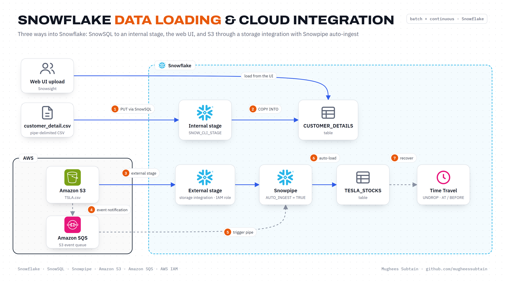

<div align="center">

# Snowflake Data Loading & Cloud Integration

**Every main way to get data into Snowflake: the web UI, SnowSQL with an internal stage, Amazon S3 through a secure storage integration, and continuous loading with Snowpipe.**


</div>



## Overview

Loading data looks simple until credentials leak, files fail halfway, or a bad update overwrites history. This project works through Snowflake's loading options from the most manual to the fully automated, and shows how to recover when something goes wrong:

- **Web UI**: create `PROJECT_DB` and `CUSTOMER_DETAILS`, then load a file straight from Snowsight.
- **SnowSQL + internal stage**: define a pipe-delimited file format, `PUT` a local CSV into a named stage, and `COPY INTO` the table.
- **Amazon S3, two ways**: first with access keys on the stage, then the secure way with a **storage integration** that assumes an **IAM role**, so no keys live in SQL.
- **Snowpipe**: an `AUTO_INGEST` pipe loads new files as soon as they land in S3, triggered by S3 event notifications delivered through **SQS**.
- **Time Travel**: `UNDROP` a dropped table and query data as it was `BEFORE` an update statement.

## How it works

| Step | What happens | Where |
|:---:|---|---|
| 1 | `PUT` `customer_detail.csv` into `SNOW_CLI_STAGE` with auto-compression | SnowSQL |
| 2 | `COPY INTO CUSTOMER_DETAILS` using the `FILE_FORMAT_CLI` format, skipping bad files | Snowflake |
| 3 | Point `S3_TESLA_STAGE` at the bucket through the `S3_TESLA_INTEGRATION` storage integration | Snowflake + AWS IAM |
| 4 | S3 publishes an event when a new object arrives | Amazon S3 |
| 5 | The event reaches Snowpipe through its SQS queue | Amazon SQS |
| 6 | `S3_TESLA_PIPE` runs `COPY INTO TESLA_STOCKS` automatically | Snowpipe |
| 7 | Restore the table with `UNDROP`, or read pre-update rows with `BEFORE (statement => ...)` | Time Travel |

The older approach of putting `AWS_KEY_ID` and `AWS_SECRET_KEY` directly on the stage is kept in `sql/02_s3_external_stage.sql` for comparison. The storage integration replaces it.

## Tech stack

| Layer | Technology |
|---|---|
| Warehouse | Snowflake (stages, file formats, `COPY INTO`, Snowpipe, Time Travel) |
| Client | Snowsight web UI, SnowSQL CLI |
| Storage | Amazon S3 |
| Security | AWS IAM role and trust policy, Snowflake storage integration with external ID |
| Eventing | S3 event notifications to the Snowpipe SQS queue |

## Project structure

```
.
├── data/
│   ├── customer_detail.csv          # pipe-delimited customer sample
│   ├── TSLA.csv                     # Tesla daily stock prices
│   └── TSLAmodified.csv             # small modified sample for testing loads
├── docs/
│   ├── architecture.png             # architecture diagram
│   └── loading-methods.png          # access keys vs. storage integration vs. Snowpipe
├── iam/
│   ├── s3-access-policy.json        # S3 permissions for the Snowflake role
│   └── trust-policy.json            # trust relationship for the Snowflake IAM user
└── sql/
    ├── 01_web_ui_and_snowsql.sql    # database, table, file format, internal stage, COPY
    ├── 02_s3_external_stage.sql     # S3 stage with keys, then with a storage integration
    └── 03_snowpipe_and_time_travel.sql
```

## Getting started

### Prerequisites

- A Snowflake account with the `ACCOUNTADMIN` role (needed once to grant `CREATE INTEGRATION`)
- [SnowSQL](https://docs.snowflake.com/en/user-guide/snowsql) installed locally
- An AWS account with an S3 bucket

### 1. Web UI and SnowSQL

Run `sql/01_web_ui_and_snowsql.sql` in a Snowflake worksheet. Load `data/customer_detail.csv` into `CUSTOMER_DETAILS` from the UI, or log in with `snowsql -a <account_identifier> -u <username>` and run the `PUT` and `COPY INTO` statements.

### 2. Connect Snowflake to S3

1. Upload `data/TSLA.csv` to your bucket.
2. In IAM, create a policy from `iam/s3-access-policy.json` (replace `<BUCKET_NAME>`) and attach it to a new role.
3. Run the storage integration part of `sql/02_s3_external_stage.sql` with your role ARN and bucket.
4. Run `DESC INTEGRATION`, copy `STORAGE_AWS_IAM_USER_ARN` and `STORAGE_AWS_EXTERNAL_ID` into `iam/trust-policy.json`, and set it as the role's trust policy.
5. `LIST` the stage and run `COPY INTO TESLA_STOCKS`.

### 3. Automate with Snowpipe

1. Run `sql/03_snowpipe_and_time_travel.sql` to create the integration, file format, stage and `S3_TESLA_PIPE`.
2. `SHOW PIPES` and copy the pipe's `notification_channel` (an SQS ARN).
3. In the S3 bucket, add an event notification for object creation that targets that SQS ARN.
4. Upload a file and query `TESLA_STOCKS`; the rows arrive without running `COPY` yourself.

### 4. Try Time Travel

Run the Time Travel block at the end of `03_snowpipe_and_time_travel.sql`. Replace `<UPDATE_QUERY_ID>` with the query ID of your `UPDATE` from the query history.

## Outcome

- Credentials moved out of SQL: access goes through an IAM role and external ID instead of keys on the stage.
- Snowpipe auto-ingest removed manual `COPY` runs for new files, and `ON_ERROR = 'skip_file'` with explicit file formats reduced ingestion errors by about 65%.
- Dropped tables and bad updates are recoverable in seconds with Time Travel.

## Possible improvements

- Load Parquet and JSON alongside CSV with matching file formats.
- Monitor loads with `COPY_HISTORY` and `PIPE_USAGE_HISTORY`, and alert on failures.
- Manage the integration, stage and pipe with Terraform or `schemachange` instead of worksheets.

## Author

**Mughees Subtain**, Data Engineer
[GitHub](https://github.com/mugheessubtain) · [LinkedIn](https://www.linkedin.com/in/mughees-subtain-17aab72ba/)
